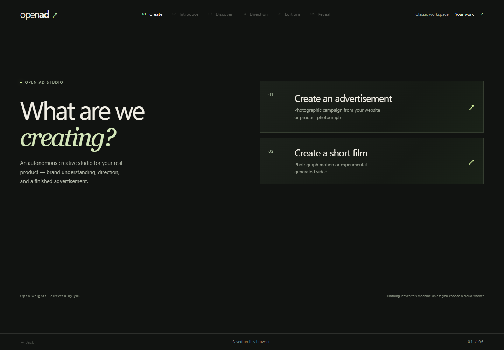

# Open Ad Studio

**Turn your product evidence into an advertisement you can inspect, edit and keep.**

[Get started](#quick-start) · [Connect AI](docs/CONNECT_AI.md) · [Judge guide](docs/JUDGE_GUIDE.md) · [Demo plan](docs/SUBMISSION.md)

Bring a business website or your own product photograph. Review the evidence, choose a creative direction, create a campaign and finish it with editable typography. Your original product stays available for comparison.

The [current release assessment](docs/release/STATUS.md) records genuine local Qwen → Comfy Cloud FLUX → edit/export/reload browser acceptance, clean Product-safe startup, and the remaining product-quality limits. Cloud credentials and spending stay disabled in public clones.

### What it does

- Discovers products and brand evidence from accessible websites.
- Keeps local Qwen planning, authored directions and Basic drafts clearly identified.
- Offers Product-safe design plus separately configured open-weight photography engines.
- Carries product constraints and composition into generation and product review.
- Places editable headline, supporting copy and optional CTA around the photograph.
- Exports PNGs and saves projects in your browser; optional FFmpeg photograph-motion MP4.

### Quick start

**Install [Node.js 22.18+](https://nodejs.org/) with npm once.** Internet access is needed for the first application-package install. No AI models are downloaded by the launcher.

| Your computer | Launch |
| --- | --- |
| Windows | [Download ZIP](https://github.com/moonz-1/open-ad-studio/archive/refs/heads/main.zip), extract it completely, double-click **start.cmd**. |
| macOS | Extract the ZIP, right-click **start.command** → Open. If needed, run `sh start.command` from that folder. |
| Linux | Extract the ZIP, then run `sh start.command` from that folder. |

The launcher installs missing application packages, builds the app and asks your default browser to open Journey. If it stays closed, use the printed address. Keep its window open while working. It reuses its running installation or selects a free local port without stopping another process. **Use the same displayed address for your saved projects.**

Prefer Git? Clone this repository and run the same launcher. [Troubleshooting and manual commands](docs/INSTALL.md).

### Connect your AI

**Try it now, without AI.** Upload an authorized photograph, choose **Basic draft** under **Advanced · product details & planning** and **Product-safe design** for generation. This uses your original photograph and digital layout; it does not generate AI pixels.

**Local ComfyUI.** Connect an existing installation and install only the models you choose. Qwen plans creative directions; Klein or FLUX generates photography when your backend supports it. [Local connection guide](docs/CONNECT_AI.md#local-comfyui).

**Comfy Cloud, optional.** API access requires an eligible paid subscription, an API key and compatible models. Generations consume credits. The native Cloud adapter is included as experimental, with spending off by default. Full paid Journey acceptance is not certified by this release audit. [Secure setup and release status](docs/CONNECT_AI.md#comfy-cloud).

### How it works

**Website → Product evidence → Creative direction → Generate → Compare → Edit → Export**

The Comfy SDK runs the included [native ComfyUI workflows](shared/workflows/CONTRACT.md) through a local SDK proxy or the optional Cloud transport. Graphic Art Director adds digital typography afterwards, keeping your approved words editable. Product identity and framing checks help reveal mismatches; you still review the result before publication.

### Built with

React · TypeScript · Vite · ComfyUI · Comfy SDK · Qwen · FLUX/Klein · Resvg · optional FFmpeg.

### Requirements & limitations

Node.js 22.18+ and npm are required. Git is optional for ZIP downloads. Local AI needs separately installed ComfyUI, models and suitable GPU memory; FLUX.3 BF16 does not fit the tested 10 GB GPU admission requirement. Cloud is paid, experimental and opt-in; public clones start with spending disabled. Website discovery cannot bypass protected sites. Photograph motion is CPU animation; generative LTX video remains experimental. [Models and licenses](docs/MODELS_AND_LICENSES.md).

### License

Application code is [MIT](LICENSE), with Open Ad Studio and original open-higgsfield contributor attribution retained. Fonts, software and models retain their own [third-party terms](docs/THIRD_PARTY_NOTICES.md). The screenshot above is the actual interface, with no customer imagery or generated result.
